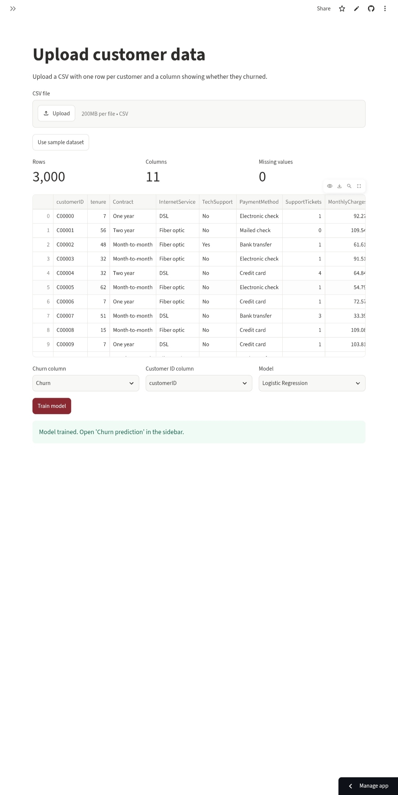
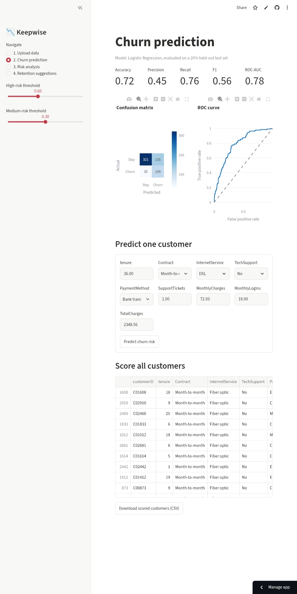
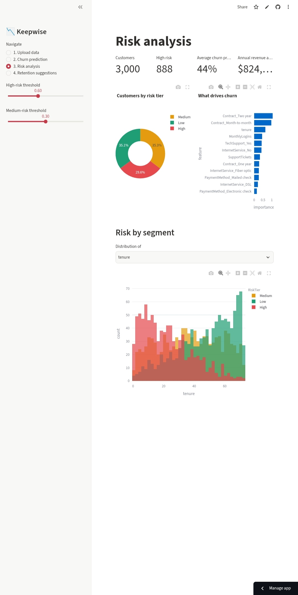

# Customer Churn Prediction and Retention Intelligence System

A Streamlit dashboard that predicts which customers are likely to leave, explains why, and suggests actions to keep them.

**Live demo:** https://churn-app-yc8bywkvfr7atzxn3z2ckw.streamlit.app/

## Screenshots

## Problem
Companies often notice churn only after revenue is lost. This project finds at-risk customers early and turns predictions into retention actions.

## Features
- Dataset upload (CSV) or built-in sample data
- Churn prediction with Logistic Regression, Random Forest or Gradient Boosting
- Model evaluation: accuracy, precision, recall, F1, ROC-AUC, confusion matrix, ROC curve
- Risk analysis: High, Medium and Low risk tiers, revenue at risk, churn drivers, segment charts
- Retention suggestions for each at-risk customer, downloadable as CSV

## Tech stack
Python, pandas, scikit-learn, Plotly, Streamlit

## How it works
CSV upload -> data cleaning -> preprocessing -> ML model -> churn probability -> risk tier -> retention actions

## Project files
- app.py: dashboard pages
- ml.py: data cleaning, training and metrics
- retention.py: retention rules
- generate_sample_data.py: creates sample data
- requirements.txt: Python packages

## Run locally
pip install -r requirements.txt
streamlit run app.py

## Author
RANGAREDDY GARI MADHAN 